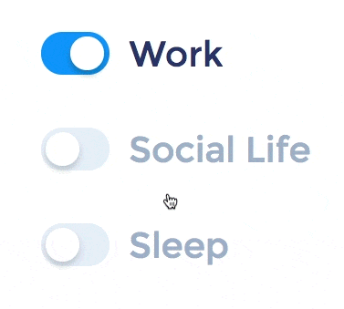
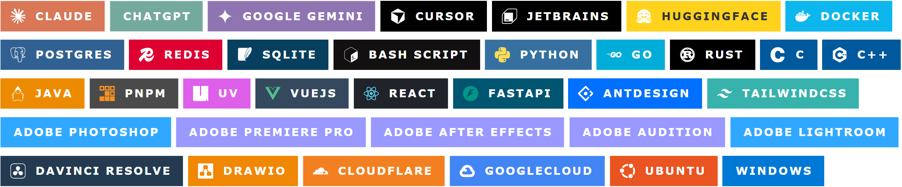
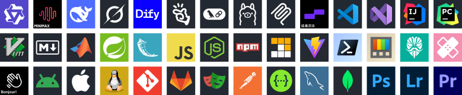

  

## About Me

<picture>
    
    
</picture>

I'm DawnMoon,a third-year undergraduate student, currently interning as an AI fullstack developer in Beijing. I love exploring new tech stack and leveraging them to build cool stuffs.

- 👩‍💻 Full Stack Developer / Prompt Engineer
- 🐱 A Siberian Forest Cat
- 🍟 McDonald's Lover
- 🌟 Hope to become someone I aspire to be
- 📫 Reach me out: [dmoon1542@gmail.com](mailto:dmoon1542@gmail.com) or [Bonjour](https://bonjour.bio/s/j7znhekm)↗

 I love connecting with different people, so if you want to say hi, I'll be happy to meet you more! ;)

 

 

## Hobbies

<picture>
    
</picture>

- Coding with AI
- Build coooooool things😎
- Watch anime and TV shows
- Play videogames
- Raising IKEA Sharks🦈
- Travel around the world

## My Tech Stack




# Statistics

<!--START_SECTION:waka-->


**🐱 My GitHub Data** 

> 📦 867.7 kB Used in GitHub's Storage 
 > 
> 🏆 567 Contributions in the Year 2026
 > 
> 🚫 Not Opted to Hire
 > 
> 📜 8 Public Repositories 
 > 
> 🔑 23 Private Repositories 
 > 
**I'm an Early 🐤** 

```text
🌞 Morning                448 commits         ██████░░░░░░░░░░░░░░░░░░░   24.28 % 
🌆 Daytime                500 commits         ███████░░░░░░░░░░░░░░░░░░   27.10 % 
🌃 Evening                627 commits         ████████░░░░░░░░░░░░░░░░░   33.98 % 
🌙 Night                  270 commits         ████░░░░░░░░░░░░░░░░░░░░░   14.63 % 
```
📅 **I'm Most Productive on Thursday** 

```text
Monday                   160 commits         ██░░░░░░░░░░░░░░░░░░░░░░░   08.67 % 
Tuesday                  209 commits         ███░░░░░░░░░░░░░░░░░░░░░░   11.33 % 
Wednesday                349 commits         █████░░░░░░░░░░░░░░░░░░░░   18.92 % 
Thursday                 461 commits         ██████░░░░░░░░░░░░░░░░░░░   24.99 % 
Friday                   254 commits         ███░░░░░░░░░░░░░░░░░░░░░░   13.77 % 
Saturday                 208 commits         ███░░░░░░░░░░░░░░░░░░░░░░   11.27 % 
Sunday                   204 commits         ███░░░░░░░░░░░░░░░░░░░░░░   11.06 % 
```


📊 **This Week I Spent My Time On** 

```text
💬 Programming Languages: 
Markdown                 18 hrs 32 mins      █████████░░░░░░░░░░░░░░░░   37.07 % 
JavaScript               8 hrs 48 mins       ████░░░░░░░░░░░░░░░░░░░░░   17.60 % 
TypeScript               7 hrs 11 mins       ████░░░░░░░░░░░░░░░░░░░░░   14.36 % 
Python                   5 hrs 7 mins        ███░░░░░░░░░░░░░░░░░░░░░░   10.25 % 
Other                    2 hrs 27 mins       █░░░░░░░░░░░░░░░░░░░░░░░░   04.91 % 
```

🤖 **AI Coding This Week** 

```text
⏱ AI Coding Time: 48 hrs 53 mins (97.69%)

✍️ 45,949 lines written by AI, 23 lines written by hand (99.95% AI-written)

🔤 104,353,980 Input Tokens, 12,584,172 Output Tokens

💵 $891.77 Estimated AI Cost This Week

🧠 83 AI Sessions, 332 AI Prompts

Opus                     21,940 lines        ████████████████████░░░░░   79.41 % 
Gemini                   2,316 lines         ██░░░░░░░░░░░░░░░░░░░░░░░   08.38 % 
Fable                    2,042 lines         ██░░░░░░░░░░░░░░░░░░░░░░░   07.39 % 
GPT                      832 lines           █░░░░░░░░░░░░░░░░░░░░░░░░   03.01 % 
Sonnet                   480 lines           ░░░░░░░░░░░░░░░░░░░░░░░░░   01.74 % 

🔎 AI Coding Insights:
🤖 AI-Driven — 99.95% of written lines came from AI
📚 Verbose Prompter — average 2,333 characters per prompt
🔁 Iterative Prompter — average 4 prompts per session
🚀 High AI Trust — 0.06% of changed lines were hand-edited
```

**I Mostly Code in Python** 

```text
HTML                     4 repos             ███░░░░░░░░░░░░░░░░░░░░░░   12.12 % 
TypeScript               2 repos             ██░░░░░░░░░░░░░░░░░░░░░░░   06.06 % 
Shell                    1 repo              █░░░░░░░░░░░░░░░░░░░░░░░░   03.03 % 
Kotlin                   1 repo              █░░░░░░░░░░░░░░░░░░░░░░░░   03.03 % 
Swift                    1 repo              █░░░░░░░░░░░░░░░░░░░░░░░░   03.03 % 
```


 Last Updated on 26/11/2026 18:00:18 UTC
<!--END_SECTION:waka-->

## Thanks

Thanks to the following projects for building this README:

- [capsule-render](https://github.com/kyechan99/capsule-render)
- [github-profile-views-counter](https://github.com/antonkomarev/github-profile-views-counter)
- [open-source-badges](https://github.com/ellerbrock/open-source-badges)
- [github-readme-quotes](https://github.com/PiyushSuthar/github-readme-quotes)
- [github-readme-streak-stats](https://github.com/DenverCoder1/github-readme-streak-stats)
- [github-readme-stats](https://github.com/anuraghazra/github-readme-stats)
- [MOBAIcons](https://github.com/Artist-MOBAI/MOBAIcons)
- [markdown-badges](https://github.com/Ileriayo/markdown-badges)
- [awesome-github-profile-readme](https://github.com/saturn-abhishek/awesome-github-profile-readme)
- [waka-readme-stats](https://github.com/anmol098/waka-readme-stats)
- [Cult of the Party Parrot](https://cultofthepartyparrot.com)

<div>
    
    
    
    
    
    
    
    
    
    
    
    
    
    
    
    
    
    
    
    
    
    
    
    
</div>
